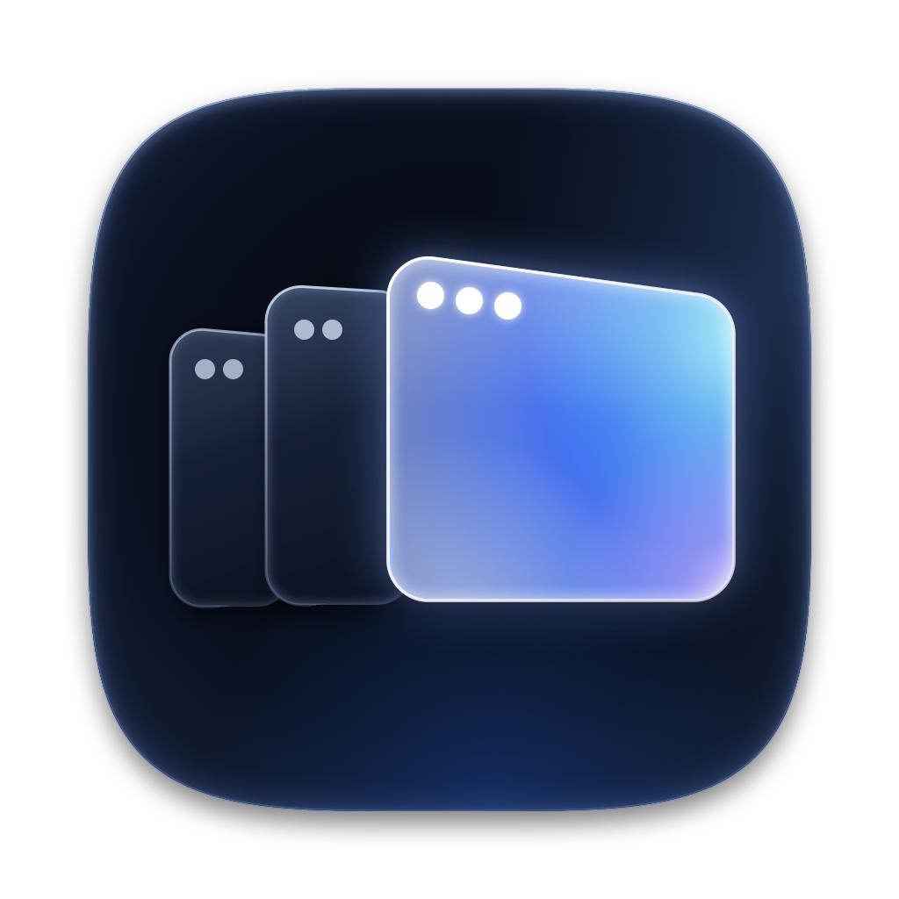
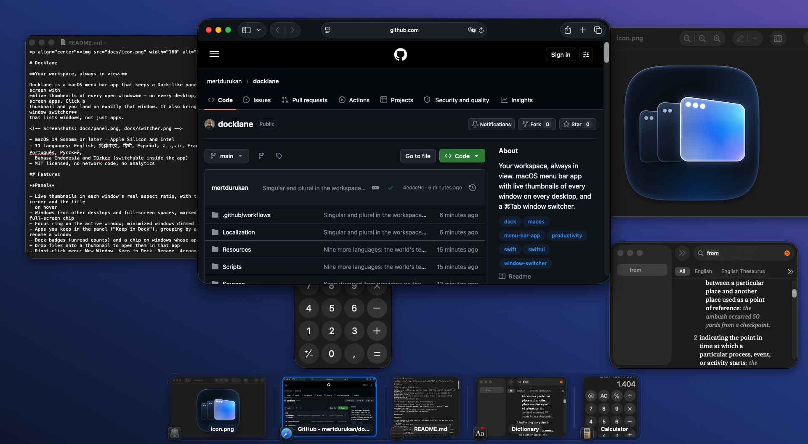
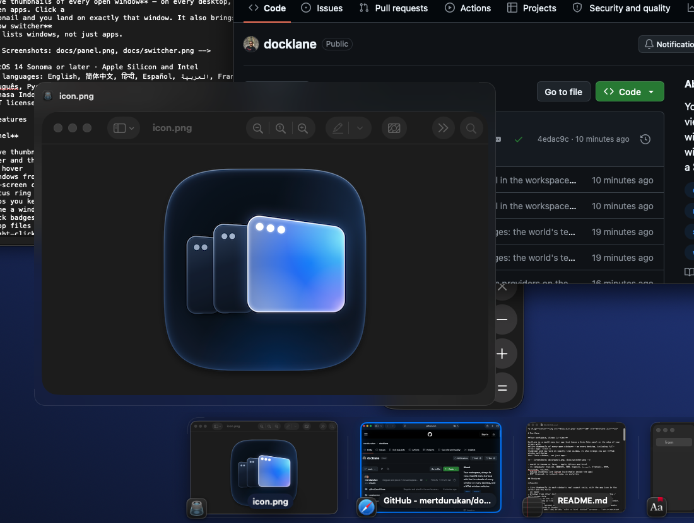
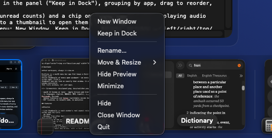
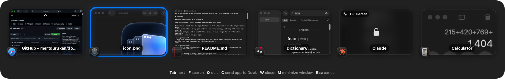
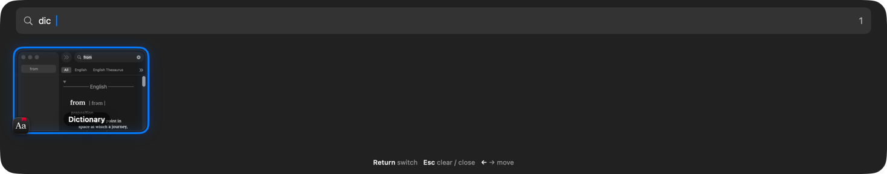
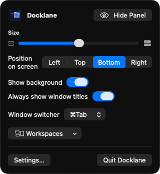
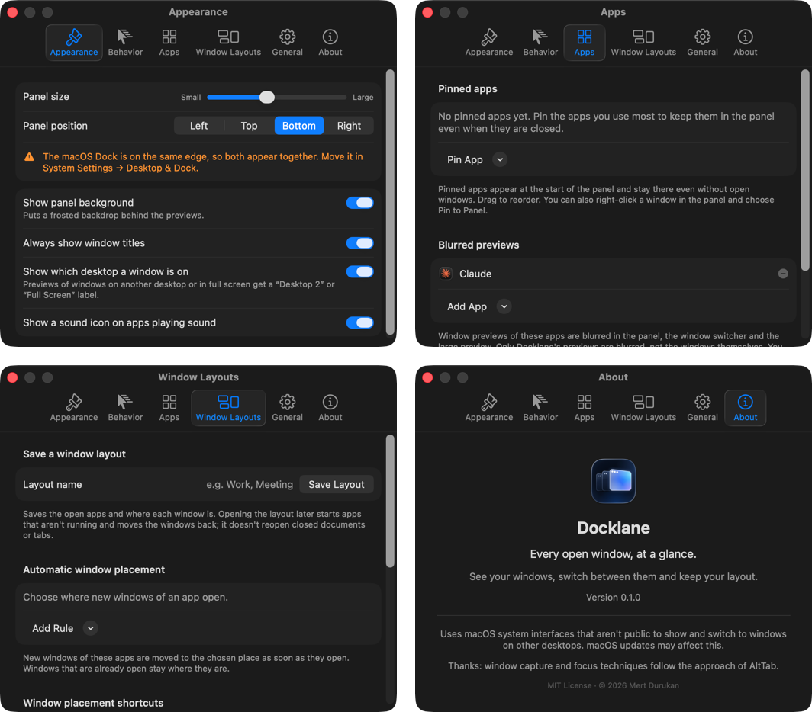

<p align="center"></p>

# Docklane

**Your workspace, always in view.**

Docklane is a macOS menu bar app that keeps a Dock-like panel on the edge of your screen with
**live thumbnails of every open window** — on every desktop, including full-screen apps. Click a
thumbnail and you land on exactly that window. It also brings its own **⌘Tab window switcher**
that lists windows, not just apps.

<p align="center">
  
</p>

<p align="center">
  <a href="https://github.com/mertdurukan/docklane/releases/latest"><b>Download the latest release</b></a>
</p>

- macOS 14 Sonoma or later · Apple Silicon and Intel
- 11 languages: English, 简体中文, हिन्दी, Español, العربية, Français, বাংলা, Português, Русский,
  Bahasa Indonesia and Türkçe (switchable inside the app)
- MIT licensed, no network code, no analytics

## Features

### The panel

Every open window as a live thumbnail, on the edge you choose. Click one and that exact window
comes to the front — even when it is on another desktop or in full screen.

- Live thumbnails in each window's real aspect ratio, with the app icon in the corner and the title
  on hover
- Windows from other desktops and full-screen spaces, marked with a desktop / full-screen chip
- Focus ring on the active window; minimized windows dimmed and sorted last
- Apps pinned to the panel ("Pin to Panel"), grouping by app, drag to reorder, rename a window
- Dock badges (unread counts) and a chip on windows whose app is playing audio
- Drop files onto a thumbnail to open them in that app
- Left, top, bottom or right edge; size slider; optional background; one panel per display
- Auto-hide (no animation), or keep it visible and Docklane moves windows out of its way
- "Only this desktop" filter, keyboard navigation (⌃⌥K) and a show/hide shortcut (⌃⌥D)

### Large live preview

Hover a thumbnail and a large, live preview of that window opens above it.

<p align="center"></p>

### Right-click a window

New Window, Pin to Panel, Rename, Move & Resize (left / right / top / bottom half, center, fill),
Blur This App's Previews, Minimize / Restore, Hide, Close Window and Quit.

<p align="center"></p>

### ⌘Tab for windows, not apps

- Every window in most-recently-used order, Finder included; one press goes to the next app
- Keys while holding ⌘, as in the system switcher and every Mac app:

  | Key | Does |
  | --- | --- |
  | Tab / ⇧Tab, \` / ⇧\`, arrows | Move |
  | Release ⌘, Return | Switch |
  | F | Search window titles and app names (diacritic-insensitive) |
  | Q / W / M | Quit the app, close or minimize the window, like ⌘Q / ⌘W / ⌘M |
  | C | Minimize every window of the app to the Dock (full-screen ones leave full screen first) |
  | Esc, ⌘. | Cancel |

  Letters follow the keyboard layout; \` uses its key position.

### ⌥Tab for desktops

- Every desktop and full-screen space as a miniature — the wallpaper with its windows where
  they really are, or the app filling it — in Mission Control order
- Hold ⌥, press Tab to move, release to go; 1–9 jump straight to one; Esc cancels
- The first press selects the desktop you used last, so a quick ⌥Tab goes back and forth
- Lands on the window you last used there; an empty desktop is reached with your own
  Mission Control shortcut (⌃1… or ⌃←/⌃→)
- ⌃⌥Tab when the window switcher uses ⌥Tab; can be turned off
- Can use ⌥Tab instead, or be turned off; optional "only this desktop" filter

<p align="center"></p>
<p align="center"></p>

### Menu bar quick controls

Show or hide the panel, size, edge, background, titles, the switcher shortcut and window layouts —
one click away.

<p align="center"></p>

### And more

- **Window memory:**
  - Window layouts: save which apps are open and where each window is (on which display), bring
    them back from the menu or from anywhere with ⌃⌥⌘1–9; optionally hide every other app
  - Display setups: connect or disconnect a display and windows go back to where they were the
    last time you used that set of displays
  - ⌃⌥Z undoes the last arrangement Docklane made (an opened layout, a display change, Move & Resize
    or a keyboard shortcut)
- **Keyboard arrangement:** ⌃⌥←/→/↑/↓ put the front window in a half (press again: a third,
  then two thirds), ⌃⌥↩ fills the screen, ⌃⌥C centers, ⌃⌥⌘←/→ move it to the other display
- **Automatic window placement:** new windows of an app go straight to their place ("Chrome: left half")
- **Live pins:** right-click a window → Pin Live Preview keeps a small live copy of it on top of
  everything, on every desktop; drag to move, resize from an edge, click to switch to it
- **Privacy blur:** blur the previews of chosen apps (password managers, banking, chat…)
  everywhere in Docklane (the windows themselves are not affected)
- Launch at login, VoiceOver labels, a warning when the macOS Dock sits on the same edge
- 11 languages with an in-app language choice

<p align="center"></p>

## Permissions

Docklane asks for two permissions on first launch. Both are granted in
**System Settings → Privacy & Security**.

| Permission | Why |
| --- | --- |
| **Accessibility** | Find windows, raise and focus the exact window you click, minimize / close / move windows, read Dock badges, and capture ⌘Tab before the system does. |
| **Screen Recording** | Draw the live thumbnails. Images stay in memory on your Mac; nothing is saved or sent anywhere. |

## Privacy

Docklane contains no networking code, no analytics and no crash reporting. Window thumbnails live
only in memory. Settings, the manual order, window names and window layouts are stored in the app's
`UserDefaults` (`io.github.mertdurukan.docklane`).

## Private APIs

Some of what Docklane does has no public API. Every private symbol is looked up at run time with
`dlsym` (`Sources/DocklaneCore/Private/PrivateSymbols.swift`); if a future macOS removes one, the
feature that needs it switches off instead of crashing.

| Symbol | Used for |
| --- | --- |
| `_AXUIElementGetWindow` | Match an Accessibility window to its window number |
| `_AXUIElementCreateWithRemoteToken` | Reach windows on other desktops and in full-screen spaces, which `kAXWindows` does not list |
| `CGSMainConnectionID` | Connection handle for the calls below |
| `CGSHWCaptureWindowList` | Thumbnails of windows that are not on screen (ScreenCaptureKit cannot capture them) |
| `_SLPSSetFrontProcessWithOptions`, `SLPSPostEventRecordTo` | Bring a specific window of an app to the front |
| `SLSCopyManagedDisplaySpaces`, `SLSCopySpacesForWindows`, `SLSGetActiveSpace` | Which desktop or full-screen space a window is on |
| `GetProcessForPID` | Process serial number for the focus calls |

Because of these, Docklane cannot be sandboxed or distributed through the Mac App Store.

## Install

### Download

1. Download `Docklane.zip` from the [latest release](https://github.com/mertdurukan/docklane/releases/latest),
   unzip it and move `Docklane.app` to `/Applications`.
2. Open it. Releases are signed with a Developer ID and notarized by Apple, so it opens like
   any other app.
3. Grant **Accessibility** and **Screen Recording** when asked.

### Build from source

You need Xcode 26 or later (Swift 6.2).

```bash
git clone https://github.com/mertdurukan/docklane.git
cd docklane
Scripts/build-app.sh
```

The script builds a release binary, assembles `Docklane.app`, signs it, copies it to
`/Applications` and launches it. Options:

| Variable | Effect |
| --- | --- |
| `INSTALL=0` | Only produce `dist/Docklane.app` |
| `ZIP=1` | Also write `dist/Docklane.zip` |
| `UNIVERSAL=1` | Apple Silicon + Intel binary |
| `SIGN_IDENTITY="…"` | Code-signing identity (default `Docklane Self-Signed`) |
| `ADHOC=1` | Install with an ad-hoc signature when the identity is missing (permissions reset on every rebuild) |
| `VERSION=…`, `BUILD=…` | Version numbers |

### Keep permissions across rebuilds

macOS ties the Accessibility and Screen Recording permissions to the app's code signature. With
an ad-hoc signature every rebuild looks like a new app and the permissions stop working. Create a
self-signed certificate once and the script will use it:

1. Open **Keychain Access → Certificate Assistant → Create a Certificate…**
2. Name: `Docklane Self-Signed`, Identity Type: *Self Signed Root*, Certificate Type:
   *Code Signing*. Create it in the **login** keychain.
3. Run `Scripts/build-app.sh` again; it prints `Signed with "Docklane Self-Signed"`.

If permissions look enabled in System Settings but do not work (typically after the signature
changed), reset them and grant them again:

```bash
tccutil reset All io.github.mertdurukan.docklane
```

## Releasing

Pushing a `v*` tag makes CI publish a GitHub release with an ad-hoc signed zip. Replace it with
a notarized build so users can open the app without an **Open Anyway** step. Once:

1. In Xcode → Settings → Accounts → *your team* → Manage Certificates, add a
   **Developer ID Application** certificate (only the team's Account Holder can create one).
2. Create an app-specific password at [account.apple.com](https://account.apple.com) → Sign-In
   and Security, then store notarization credentials in the keychain (it asks for the password):

```bash
xcrun notarytool store-credentials docklane --apple-id "you@example.com" --team-id "TEAMID"
```

Then, for each release (the app's sources must match the tag):

```bash
Scripts/release-notarized.sh 0.1.0
```

It builds a universal app with the hardened runtime, signs it with your Developer ID, notarizes
and staples it, and replaces `Docklane.zip` on the GitHub release.

## Uninstall

1. Quit Docklane from its menu bar icon.
2. Move `/Applications/Docklane.app` to the Trash.
3. Optionally remove its settings and permission entries:

```bash
defaults delete io.github.mertdurukan.docklane
```

```bash
tccutil reset All io.github.mertdurukan.docklane
```

## Development

```bash
swift build
```

```bash
swift test
```

- `Sources/DocklaneCore` — window discovery, capture, focus, layout and persistence; no UI, unit
  tested
- `Sources/Docklane` — the menu bar app: engine, panels, switcher, settings
- `Localization/Localizable.xcstrings` — English source strings and their translations;
  `Localization/InfoPlist.xcstrings` — the Screen Recording prompt. The build script compiles
  both into the bundle, and a unit test fails if any string is missing a language or a
  placeholder

## Known limitations

- DRM-protected video (for example some streaming sites) shows as a black thumbnail.
- Multiple displays have had little testing.
- Private APIs can change in any macOS update; affected features turn off rather than crash.

## Acknowledgements

Window capture and focus techniques follow the approach of
[AltTab](https://github.com/lwouis/alt-tab-macos) (GPL-3.0). Docklane is an independent
implementation and contains no AltTab code.

## License

[MIT](LICENSE) © 2026 Mert Durukan
